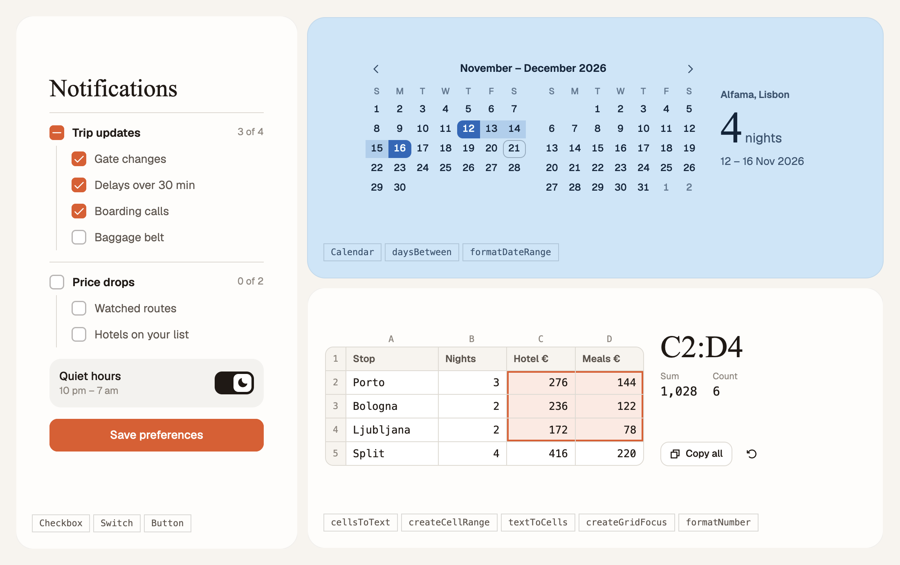

# UI SDK for gpui

An unofficial Rust port of Vercel's [UI SDK](https://ui-sdk.dev) (`@ui-sdk/core`) to [gpui](https://www.gpui.rs), the UI framework [Zed](https://zed.dev) is built with: all of its components and the behaviors they're built from.



The components are headless. Each one brings its keyboard, focus and screen reader behavior, and you render its parts (a select's trigger, items and popup) and style them from their state with gpui methods. The port follows the original closely, so the [UI SDK docs](https://ui-sdk.dev/docs) describe how every component behaves; the Rust API keeps its names, in snake_case.

> [!NOTE]
> This is a beta port of a beta library. It builds against one pinned revision of gpui, has only been run on macOS, and isn't on crates.io. It isn't affiliated with Vercel or Zed Industries.

## Quick Start

You need Rust 1.98 or later and, on macOS, Xcode's Metal toolchain (on Xcode 26 and later, `xcodebuild -downloadComponent MetalToolchain`).

Depend on a tag of this repository, with gpui from the Zed revision that tag pins:

```toml
[dependencies]
ui-sdk = { git = "https://github.com/zachsents/ui-sdk-gpui", tag = "v0.2.0" }
gpui = { git = "https://github.com/zed-industries/zed.git", rev = "2f808b3c2de049ecfdbad0fdb26763cebfcaa3b4" }
gpui_platform = { git = "https://github.com/zed-industries/zed.git", rev = "2f808b3c2de049ecfdbad0fdb26763cebfcaa3b4", features = ["font-kit"] }
env_logger = "0.11"

# Debug builds lay out slowly without these.
[profile.dev.package]
taffy = { opt-level = 3 }
resvg = { opt-level = 3 }
```

Copy the `rev` exactly: another revision means a second copy of gpui, whose types don't match the components'. When you move to a newer tag, take the gpui revision from its `Cargo.toml`. Without `font-kit`, gpui renders no text on macOS.

A switch with a label:

```rust
use gpui::prelude::*;
use gpui::{App, Bounds, Context, Entity, Window, WindowBounds, WindowOptions, div, px, rgb, size};
use ui_sdk::components::label::{Label, LabelOptions};
use ui_sdk::components::switch::{Switch, SwitchOptions};
use ui_sdk::foundation::platform::live_regions;

struct Settings {
    wifi: Entity<Switch>,
    wifi_label: Entity<Label>,
}

impl Settings {
    fn new(window: &mut Window, cx: &mut Context<Self>) -> Self {
        let wifi = cx.new(|cx| {
            Switch::new(
                SwitchOptions::default()
                    .id("wifi")
                    .default_checked(true)
                    .on_checked_change(|checked, details, _window, _cx| {
                        println!("Wi-Fi {checked} ({})", details.reason.as_str());
                    }),
                window,
                cx,
            )
        });
        let wifi_label = cx.new(|cx| Label::new(LabelOptions::default().for_id("wifi").text("Wi-Fi"), window, cx));
        Self { wifi, wifi_label }
    }
}

impl Render for Settings {
    fn render(&mut self, window: &mut Window, cx: &mut Context<Self>) -> impl IntoElement {
        let thumb = Switch::thumb(&self.wifi, cx)
            .size(px(16.))
            .rounded_full()
            .bg(rgb(0xffffff));
        let switch = Switch::root(&self.wifi, cx)
            .with(|el, state| {
                el.bg(if state.checked { rgb(0x2563eb) } else { rgb(0x9ca3af) })
                    .when(state.checked, |el| el.justify_end())
            })
            .flex()
            .w(px(36.))
            .p(px(2.))
            .rounded_full()
            .child(thumb);
        div()
            .size_full()
            .flex()
            .items_center()
            .gap_2()
            .p_4()
            .bg(rgb(0xffffff))
            .child(switch)
            .child(Label::root(&self.wifi_label, cx).child("Wi-Fi"))
            .child(live_regions(window))
    }
}

fn main() {
    gpui_platform::application().run(|cx: &mut App| {
        ui_sdk::init("ui-sdk-quickstart", cx);
        let bounds = Bounds::centered(None, size(px(320.), px(120.)), cx);
        cx.open_window(
            WindowOptions {
                window_bounds: Some(WindowBounds::Windowed(bounds)),
                ..Default::default()
            },
            |window, cx| cx.new(|cx| Settings::new(window, cx)),
        )
        .unwrap();
        cx.activate(true);
    });
}
```

- The switch is an entity, made once from its options, and keeps its own state from `default_checked` on.
- `Switch::root` and `Switch::thumb` are its parts: divs with the role, focus and key handling already on them. `with` styles a part from its state.
- `on_checked_change` hears each change, with why (`details.reason`), how (`details.source`, like mouse or keyboard), and `details.cancel()` to refuse it.
- The label points at the switch through `for_id`, so a press on it toggles the switch, and its `text` is the switch's name. gpui can't read back the text an element draws, so the name is given apart from the `"Wi-Fi"` it draws.
- `ui_sdk::init` binds Tab to move focus and names the directory saved state goes in. `live_regions` is where a window's screen reader announcements go.

It's [`crates/ui-sdk/examples/quickstart.rs`](crates/ui-sdk/examples/quickstart.rs): `cargo run -p ui-sdk --example quickstart`.

Debug builds log the mistakes the components can detect, like a control with no accessible name. gpui installs no logger, so start one at the top of `main`:

```rust
env_logger::Builder::from_env(env_logger::Env::default().default_filter_or("warn")).init();
```

## Documentation

- [Getting Started](docs/getting-started.md): a select, a slider and an alert dialog, step by step.
- [Using Components](docs/using-components.md): parts, state and callbacks, accessible names, popups, lists and forms in Rust.
- [Agent Bridge](docs/agent-bridge.md): letting an AI agent read and operate your windows.
- [Components](docs/components.md): every component's crate, example and UI SDK page.
- [Differences From the Original](docs/differences.md): how the original's concepts map to Rust, and what's missing.

[API reference](https://zachsents.github.io/ui-sdk-gpui/), or `cargo doc --open -p ui-sdk`.

## Components

| Group | Components |
| --- | --- |
| Actions | Button, Toggle, Toggle Group, Toolbar, Menu, Menubar |
| Inputs | Input, Textarea, Input Group, Password Input, OTP Input, Number Input, Token Input, File Input, Color Picker, Image Cropper |
| Choices | Checkbox, Checkbox Group, Radio, Switch, Slider, Rating, Segmented Control |
| Dates | Calendar, Date Input, Time Input, Date Picker |
| Lists | Select, Combobox, Autocomplete, Listbox, Command, Trigger Menu, Tree, Waterfall |
| Overlays | Dialog, Alert Dialog, Drawer, Popover, Tooltip, Hover Card, Toast |
| Navigation and layout | Tabs, Navigation Menu, Pagination, Accordion, Collapsible, Carousel, Scroll Area, Resizable, Separator |
| Forms | Field, Field Set, Field Group, Label |
| Display | Avatar, Progress, Meter, Timeline |

Related components share crates; `ui-sdk-select` is re-exported as `ui_sdk::components::select`. The behaviors under them, like roving focus, typeahead, drag and drop, popup placement and gestures, are crates under `ui_sdk::foundation`, for components of your own.

## The Gallery

Every example in one window, plus four tiles rebuilt from the original's [sink](https://ui-sdk.dev/sink):

```sh
cargo run --release -p ui-sdk-gallery
```

Or one at a time: `cargo run -p ui-sdk-select --example select`.

## Status

- Ports `@ui-sdk/core` 0.1.0-beta.13 ([`vercel-labs/ui@855bc7f`](https://github.com/vercel-labs/ui/tree/855bc7fd4df3d61aee33d9d975dc3e4f71debc6c), November 20, 2026), including the agent bridge, `observe` and undo history.
- Built and run on macOS only. gpui supports Linux and Windows, but this port hasn't been built there.
- No automated test suite. Every component example has been run in the gallery.
- [Known gaps](docs/differences.md#known-gaps).

## Contributing

[CONTRIBUTING.md](CONTRIBUTING.md) covers building, checking a change and porting upstream changes.

## License

Apache-2.0, like the original. UI SDK is copyright Vercel, Inc.; see [NOTICE](NOTICE).
