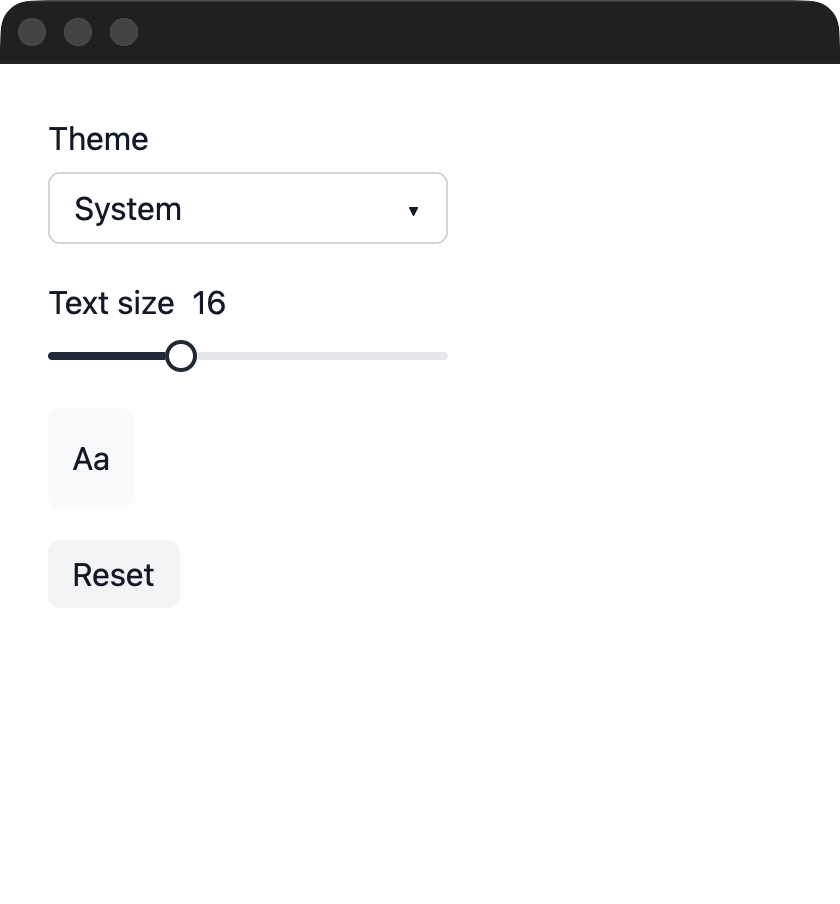

# Getting Started

Let's build a small settings window: a select for the theme, a slider for the text size, a preview that follows both, and a Reset button that asks before it resets them.



The finished program is [`crates/ui-sdk/examples/settings.rs`](../crates/ui-sdk/examples/settings.rs) (`cargo run -p ui-sdk --example settings`).

## Create the Project

Start a binary crate with the [README's requirements, dependencies and debug profile](../README.md#quick-start):

```sh
cargo new settings
cd settings
```

```toml
[dependencies]
ui-sdk = { git = "https://github.com/zachsents/ui-sdk-gpui", tag = "v0.5.0" }
gpui = { git = "https://github.com/zed-industries/zed.git", rev = "2f808b3c2de049ecfdbad0fdb26763cebfcaa3b4" }
gpui_platform = { git = "https://github.com/zed-industries/zed.git", rev = "2f808b3c2de049ecfdbad0fdb26763cebfcaa3b4", features = ["font-kit"] }

[profile.dev.package]
taffy = { opt-level = 3 }
resvg = { opt-level = 3 }
```

The first build compiles gpui and takes a few minutes.

## Open a Window

An empty view in a window:

```rust
use gpui::prelude::*;
use gpui::{App, Bounds, Context, Window, WindowBounds, WindowOptions, div, px, rgb, size};
use ui_sdk::foundation::platform::live_regions;

struct Settings {}

impl Settings {
    fn new(_window: &mut Window, _cx: &mut Context<Self>) -> Self {
        Self {}
    }
}

impl Render for Settings {
    fn render(&mut self, window: &mut Window, _cx: &mut Context<Self>) -> impl IntoElement {
        div()
            .size_full()
            .flex()
            .flex_col()
            .items_start()
            .gap_4()
            .p_6()
            .bg(rgb(0xffffff))
            .text_color(rgb(0x111827))
            .child(live_regions(window))
    }
}

fn main() {
    gpui_platform::application().run(|cx: &mut App| {
        ui_sdk::init("ui-sdk-settings", cx);
        let bounds = Bounds::centered(None, size(px(420.), px(420.)), cx);
        cx.open_window(
            WindowOptions {
                window_bounds: Some(WindowBounds::Windowed(bounds)),
                ..Default::default()
            },
            |window, cx| cx.new(|cx| Settings::new(window, cx)),
        )
        .unwrap();
        cx.activate(true);
    });
}
```

Two lines are for the components. `ui_sdk::init` binds Tab and Shift+Tab, which gpui leaves unbound, and names the directory saved state goes in (`~/Library/Application Support/ui-sdk-settings` on a Mac); call it once, before opening a window. `live_regions(window)` renders the invisible regions screen reader announcements go through; render it once in every window.

`cargo run` should open a blank white window.

## Add a Select

A component is a gpui entity. Make it once, in the view's constructor, from its options:

```rust
use gpui::{Entity, SharedString};
use ui_sdk::components::select::{Select, SelectOptions};

struct Settings {
    theme: Entity<Select>,
}

impl Settings {
    fn new(window: &mut Window, cx: &mut Context<Self>) -> Self {
        let theme = cx.new(|cx| {
            Select::new(
                SelectOptions::default().default_value(Some(SharedString::from("system"))),
                window,
                cx,
            )
        });
        Self { theme }
    }
}
```

`default_value` is where the select starts; from then on it keeps its own value. Values are `SharedString` keys unless you give the select another type (`Select<T>`).

The select draws nothing. Render its parts: a label, a trigger with the value inside, and the popup with an item per theme:

```rust
use ui_sdk::components::select::{SelectContentProps, SelectItemProps, SelectTriggerProps, SelectValueProps};

const THEMES: &[(&str, &str)] = &[("light", "Light"), ("dark", "Dark"), ("system", "System")];

impl Settings {
    fn theme_select(&self, cx: &App) -> impl IntoElement {
        let label = Select::label(&self.theme, cx).aria_label("Theme").child("Theme");
        let value = Select::value_part(&self.theme, SelectValueProps::default(), cx)
            .with(|el, state| el.child(state.text.clone()));
        let trigger = Select::trigger(&self.theme, SelectTriggerProps::default(), cx)
            .flex()
            .justify_between()
            .w(px(200.))
            .px_3()
            .py_1()
            .border_1()
            .border_color(rgb(0xd1d5db))
            .rounded_md()
            .focus_visible(|style| style.border_color(rgb(0x2563eb)))
            .child(value)
            .child("▾");
        let content = Select::content(&self.theme, SelectContentProps::default(), cx).map(|content| {
            content
                .flex()
                .flex_col()
                .min_w(px(200.))
                .p_1()
                .bg(rgb(0xffffff))
                .border_1()
                .border_color(rgb(0xd1d5db))
                .rounded_md()
                .shadow_md()
                .children(THEMES.iter().map(|&(value, name)| {
                    Select::item(&self.theme, SelectItemProps::new(value).text(name), cx)
                        .with(|el, state| {
                            el.when(state.highlighted, |el| el.bg(rgb(0xeff6ff)))
                                .when(state.selected, |el| el.font_weight(gpui::FontWeight::SEMIBOLD))
                        })
                        .px_2()
                        .py_1()
                        .rounded_sm()
                        .child(name)
                }))
        });
        div()
            .flex()
            .flex_col()
            .gap_1()
            .child(label)
            .child(trigger)
            .children(content)
    }
}
```

In `render`, rename `_cx` to `cx` and add `.child(self.theme_select(cx))` before the live regions.

- Part functions take the entity and return a `Part`, which you style and give children like a `div`. `with` styles it from its state: the value part shows `state.text`, and an item reads `state.highlighted` and `state.selected`.
- When open, the content renders above the window, placed against the trigger, wherever you put it in the tree.
- gpui can't read back the text an element draws. So an item carries its text in its props (`.text(name)`), which is what the trigger shows once it's chosen, what typeahead matches and what a screen reader reads, and the label gets its text as an `aria_label` as well as drawing it.

Run it. The select behaves as the UI SDK's [Select](https://ui-sdk.dev/docs/react/components/select) page describes, keyboard included.

## Add a Slider

A slider's value type is a type parameter: `f64` for one thumb, `Vec<f64>` for a range. Add a `text_size: Entity<Slider<f64>>` field, make it in `new` before `Self { theme }`, and change that return to `Self { theme, text_size }`:

```rust
use ui_sdk::components::slider::{Slider, SliderOptions};

let text_size = cx.new(|cx| {
    Slider::new(
        SliderOptions::default().min(12.0).max(24.0).default_value(16.0),
        window,
        cx,
    )
});
```

Its parts are the root, the control you press along, the track, the indicator that fills it, a thumb per value, and the formatted value:

```rust
impl Settings {
    fn text_size_slider(&self, cx: &App) -> impl IntoElement {
        let thumb = Slider::thumb(&self.text_size, 0, cx)
            .aria_label("Text size")
            .size_4()
            .rounded_full()
            .border_2()
            .border_color(rgb(0x1f2937))
            .bg(rgb(0xffffff))
            .focus_visible(|style| style.border_color(rgb(0x2563eb)));
        let track = Slider::track(&self.text_size, cx)
            .w_full()
            .h(px(4.))
            .rounded_full()
            .bg(rgb(0xe5e7eb))
            .child(Slider::indicator(&self.text_size, cx).rounded_full().bg(rgb(0x1f2937)))
            .child(thumb);
        let control = Slider::control(&self.text_size, cx)
            .flex()
            .items_center()
            .w(px(200.))
            .h(px(20.))
            .child(track);
        let value = Slider::value(&self.text_size, cx).with(|el, state| el.child(state.text.clone()));
        Slider::root(&self.text_size, cx)
            .flex()
            .flex_col()
            .gap_1()
            .child(div().flex().gap_2().child("Text size").child(value))
            .child(control)
    }
}
```

Add `.child(self.text_size_slider(cx))` after the select. The thumb and indicator place themselves along the track from the value. The thumb takes focus and is what a screen reader announces, so the name goes there.

## Show the Settings

The preview follows both controls. Read their values at the top of `render`. A select's value is a `ListValue`, which holds one key or several; `first()` reads a single select's:

```rust
let theme = self.theme.read(cx).value().first().cloned().unwrap_or_default();
let text_size = self.text_size.read(cx).get_value();
```

Draw a sample with them, and add `.child(preview(&theme, text_size))` after the slider:

```rust
use gpui::Div;

fn preview(theme: &str, text_size: f64) -> Div {
    let (background, foreground) = match theme {
        "dark" => (rgb(0x111827), rgb(0xf9fafb)),
        _ => (rgb(0xf9fafb), rgb(0x111827)),
    };
    div()
        .p_3()
        .rounded_md()
        .bg(background)
        .text_color(foreground)
        .text_size(px(text_size as f32))
        .child("Aa")
}
```

A view redraws whenever a component whose parts it renders changes, so the preview keeps up on its own. A view that shows a component's value without rendering its parts has to observe it:

```rust
cx.observe(&theme, |_, _, cx| cx.notify()).detach();
```

To act on a change, use the component's callback, like `SelectOptions::on_value_change` ([State and Events](using-components.md#state-and-events)).

## Ask Before Resetting

Add a `reset: Entity<AlertDialog>` field. In `new`, create it with `let reset = cx.new(|cx| AlertDialog::new(AlertDialogOptions::default(), window, cx));` and return `Self { theme, text_size, reset }`. Render its trigger, backdrop and content:

```rust
use gpui::{Rgba, rgba};
use ui_sdk::components::dialog::{
    AlertDialog, AlertDialogOptions, DialogCloseProps, DialogCloseState, DialogContentProps, DialogTriggerProps,
};
use ui_sdk::kernel::{ActionOutcome, ChangeOptions, Part};

impl Settings {
    fn reset_dialog(&self, cx: &App) -> impl IntoElement {
        let trigger = AlertDialog::trigger(&self.reset, "reset", DialogTriggerProps::default(), cx)
            .px_3()
            .py_1()
            .rounded_md()
            .bg(rgb(0xf3f4f6))
            .aria_label("Reset")
            .child("Reset");
        let backdrop = AlertDialog::backdrop(&self.reset, None, cx).map(|backdrop| backdrop.bg(rgba(0x0000004d)));
        let theme = self.theme.clone();
        let text_size = self.text_size.clone();
        let confirm = DialogCloseProps::default()
            .value("reset")
            .action(move |_event, _details, window, cx| {
                theme.update(cx, |select, cx| {
                    select.set_value(Some(SharedString::from("system")), ChangeOptions::default(), window, cx);
                });
                text_size.update(cx, |slider, cx| {
                    slider.set_value(16.0, ChangeOptions::default(), window, cx);
                });
                ActionOutcome::Done
            });
        let content = AlertDialog::content(&self.reset, DialogContentProps::default(), cx).map(|content| {
            content
                .with(|el, _| el.m_auto().flex().flex_col().gap_3().w(px(280.)).p_4().rounded_md().bg(rgb(0xffffff)))
                .child(AlertDialog::title(&self.reset, cx).aria_label("Reset settings?").child("Reset settings?"))
                .child(
                    div()
                        .flex()
                        .justify_end()
                        .gap_2()
                        .child(button(
                            AlertDialog::close_part(&self.reset, "cancel", DialogCloseProps::default(), cx),
                            "Cancel",
                            rgb(0xf3f4f6),
                        ))
                        .child(button(AlertDialog::close_part(&self.reset, "confirm", confirm, cx), "Reset", rgb(0xfee2e2))),
                )
        });
        div().child(trigger).children(backdrop).children(content)
    }
}

fn button(part: Part<DialogCloseState>, label: &'static str, color: Rgba) -> Part<DialogCloseState> {
    part.aria_label(label).px_3().py_1().rounded_md().bg(color).child(label)
}
```

- A dialog can have several triggers, so each takes a key (`"reset"`). The backdrop and content render above the window while it's open.
- The trigger, the title and the answers carry their text as an `aria_label`, like the select's label. The title's is the dialog's name.
- Each close part is an answer. The confirm answer's `action` runs before the dialog closes and calls the components' own `set_value`, the method a pick goes through, with `ChangeOptions::default()` marking the change as the app's. An action can return `ActionOutcome::wait(future)` instead, which keeps the dialog open, `pending`, until the future finishes.

Add `.child(self.reset_dialog(cx))` in `render`, and the window is done.

## Keep Going

- [Using Components](using-components.md): controlled state, callbacks, popups, lists and forms.
- [Components](components.md): every component's example.
- The UI SDK's [Slider](https://ui-sdk.dev/docs/react/components/slider) and [Alert Dialog](https://ui-sdk.dev/docs/react/components/alert-dialog) pages, for their behavior and options.
